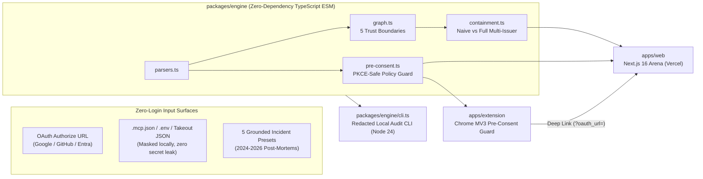

# ScopeBomb

**Live Web Arena:** https://scopebomb.vercel.app  
**Track:** INNOVEX 2026 — PS 05 (AI-Powered Cybersecurity)  
**Repository:** https://github.com/Xombi17/INNOVEX

OAuth & Shadow-AI Blast-Radius, Persistence & Multi-Issuer Containment Simulator — proves why a single `POST /revoke` (`HTTP 200 OK`) leaves attackers inside downstream ecosystems, and intercepts over-scoped OAuth grants before the PKCE handshake.

---

## Core Engineering Insights

1. **The RFC 7009 "HTTP 200 Trap":** Under RFC 7009, an authorization server returns `HTTP 200 OK` even for invalid or already-revoked tokens, and access-token cascading is only `SHOULD` (not `MUST`). Self-contained JWTs stay active until expiry, while GitHub workflows, minted service-account keys, and `.mcp.json` / `.env` static credentials (`VERCEL_TOKEN`, `OPENAI_API_KEY`, `GITHUB_TOKEN`, etc.) live at **different issuers** untouched by a single provider revoke.
2. **Issuer-Accurate Multi-Endpoint Remediation:** Rather than inventing RFC 7009 calls everywhere, ScopeBomb pairs Google `POST oauth2.googleapis.com/revoke`, GitHub OAuth Grant Deletion (`DELETE /applications/{client_id}/grant` with Basic auth + JSON `access_token` body expecting `204`), and provider-specific key rotation (`Vercel`, `OpenAI`, `Anthropic`, Entra app cleanup) with post-revocation API verification probes (`401`/`403`) — never executing destructive live calls.
3. **PKCE-Safe Pre-Consent Guard (`apps/extension`):** Under RFC 7636, an initiating client binds a secret `code_verifier` to `code_challenge = BASE64URL(SHA256(code_verifier))` and `state`. Naive mid-flight `scope=` URL rewriting breaks or desyncs that transaction. ScopeBomb blocks high-risk requests pre-consent, recommends least-privilege scopes (`drive` -> `drive.file`, `gmail.modify` -> `gmail.readonly`, `repo`/`workflow` -> fine-grained PAT), and strips stale `code_challenge`/`state` for fresh client initiation.

---

## Architecture



---

## `<90s` Judge Demo Flow (Zero Sign-In Required)

1. **Trigger 4-Hop Domino Graph (`0:00–0:25`):** Open https://scopebomb.vercel.app (loads `rohan_mcp_oauth_trap` cleanly with SSR, zero login wall) or switch between the 5 incident presets, paste an OAuth URL, drop `.mcp.json`/`.env`, or paste Google Takeout JSON.
2. **Expose the HTTP 200 Trap (`0:25–0:55`):** Keep **Simulate Naive Containment (RFC 7009)** active — observe Google's `HTTP 200 OK` status alongside pulsing **RED** surviving nodes across `personal`, `developer_local`, `ci_cd`, and `vendor` trust boundaries.
3. **Verify Full Multi-Issuer Containment & PKCE Guard (`0:55–1:25`):** Click **Full Multi-Issuer Containment Plan** to turn downstream edges **GREEN** with priority-ordered issuer steps and verification probes, then trigger **Pre-Consent Guard** on the PKCE Trap URL (`code_challenge` integrity explanation + least-privilege `drive.file` / `gmail.readonly` downgrade template).

### Grounded Incident Presets (`data/scope_catalog.json`)

| Preset ID | Year | Exact Framing |
|---|---|---|
| `rohan_mcp_oauth_trap` | 2026 | Shadow-AI OAuth Over-Scope + Local MCP Secret Overlap |
| `midnight_blizzard_2024` | 2024 | OAuth App & Permission Governance Failure (Not Shadow AI) |
| `salesloft_drift_2025` | 2025 | Vendor / Supply-Chain OAuth Compromise (Multi-Path Fan-Out) |
| `context_ai_vercel_2026` | 2026 | Third-Party Shadow-Integration Risk via Google Workspace OAuth |
| `litellm_ci_2026` | 2026 | Non-Human Key Hygiene Failure + Maintainer OAuth Compromise |

---

## Quick Start

### 1. Local Redacted Audit CLI (Node 24, Zero Deps)

```bash
# Scan current or target directory (.mcp.json, .cursor/mcp.json, .env*) without leaking secret values
node packages/engine/cli.ts /path/to/project

# Emit frozen AuditReport JSON for inspection or archive
node packages/engine/cli.ts /path/to/project --json > audit-report.json
```

### 2. Chrome MV3 Pre-Consent Guard (`apps/extension`)

1. Open `chrome://extensions` in Chrome and toggle **Developer mode**.
2. Click **Load unpacked** and select `apps/extension/`.
3. Click the extension toolbar icon to test any Google, GitHub, or Microsoft Entra authorization URL — or browse directly to an over-scoped OAuth consent URL to see the pre-consent interstitial (`guard.html`) and **Open in ScopeBomb Arena** deep link (`https://scopebomb.vercel.app/?oauth_url=...`).
4. (Optional) Rebuild MV3 engine modules from `packages/engine/` anytime via:

```bash
cd apps/extension && npm run build
```

### 3. Web Arena Local Dev (`apps/web`)

```bash
cd apps/web
npm install
npm run dev
```

---

## Verification Suite

```bash
# Schema, catalog & fixture validation
python3 contracts/verify_contracts.py

# Deterministic engine + CLI unit tests (Node 24)
node --test tests/engine/*.test.ts

# Web Arena typecheck & production bundle
cd apps/web && npm run typecheck && npm run build
```
